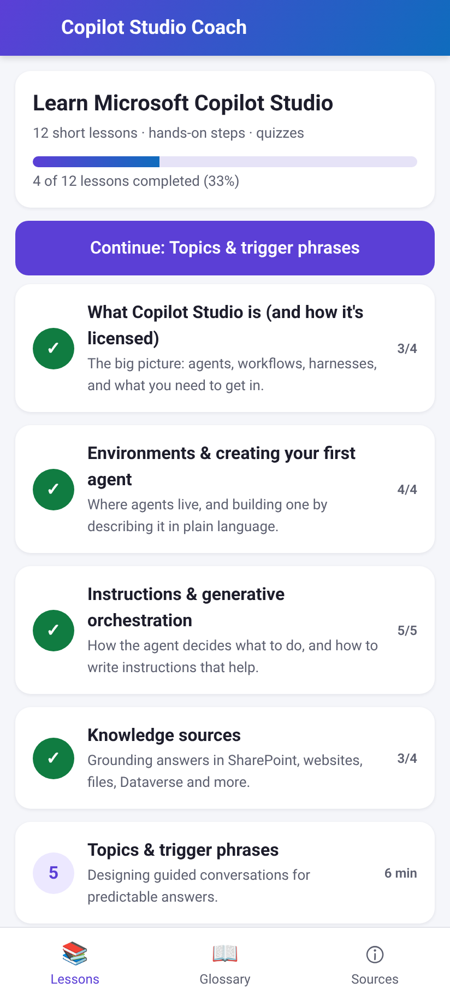
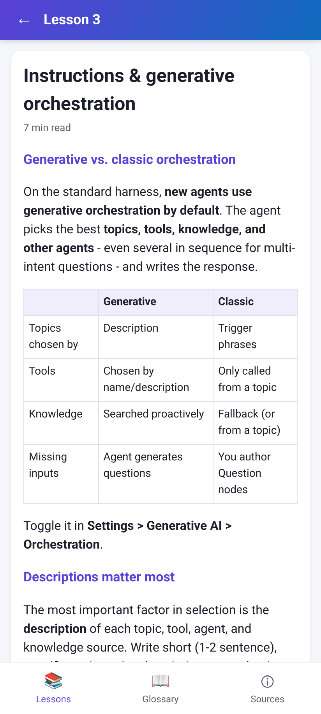
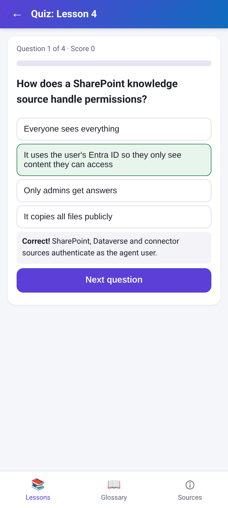

# Copilot Studio Coach – Android Study App

An offline Android app with 12 bite-size lessons, quizzes, and a glossary for learning **Microsoft Copilot Studio**. I made it to teach myself Copilot Studio before building agents with it.

> **How it was built:** I directed an AI agent (Grok Bot) to build this app with AI-assisted tooling. I chose the goal, scope, and content requirements; the agent wrote the code and lesson content from Microsoft Learn documentation (checked Oct 30, 2026). Always confirm details in the official docs, since Copilot Studio changes often.

## Screenshots
| Lesson list | Lesson | Quiz |
|---|---|---|
|  |  |  |

## Features
- 12 lessons, from what Copilot Studio is through governance and best practices. Each has a "Try it in Copilot Studio" step and a multiple-choice quiz with explanations.
- Progress tracking saved on the device (localStorage), a searchable glossary, and a sources screen linking to Microsoft Learn.
- Works fully offline.

**Lessons:** What Copilot Studio is · Environments & your first agent · Instructions & generative orchestration · Knowledge sources · Topics & trigger phrases · Nodes & variables · Entities & slot filling · Tools (flows, connectors, prompts) · Authentication & security · Publishing & channels · Testing & analytics · Governance, ALM & best practices

## How to install or run
- **Android:** download `CopilotStudioCoach.apk` from [Releases](../../releases), open it on your phone, and allow installs from unknown sources. It needs Android 7.0+ and is self-signed.
- **Browser preview:** open `app/src/main/assets/www/index.html`.
- **Build from source:** run `KS_PASS=<your password> ./build.sh`. It needs JDK 17 and the Android SDK (android-34, build-tools 34.0.0) in `tools/`, which isn't included. It doesn't use Gradle.

## Tech
A Java `MainActivity` wraps an Android WebView that loads bundled HTML, CSS, and JavaScript. It is built with the plain Android SDK command-line tools (aapt2, d8, zipalign, apksigner).

## Skills shown
Defining requirements for an AI-built tool, reviewing and testing the result, self-directed learning of Copilot Studio concepts (topics, variables, knowledge, tools, testing, publishing, governance), and documentation.
